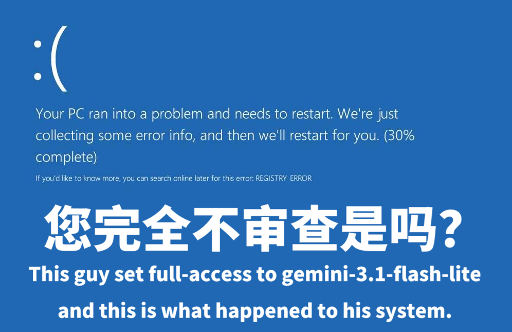
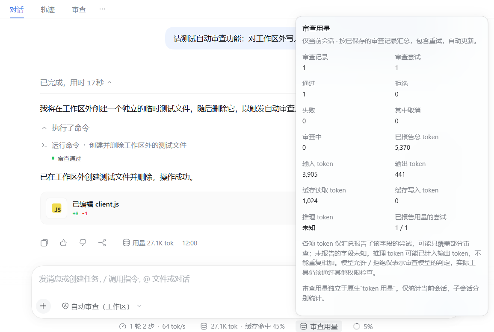

# DSH enhanced review

<a href="imgs/teaser.png"></a>

A configurable auto-review plugin inspired by Codex's review approach, with an independent reviewer model, workspace sandboxing, failure fallback, deletion protection, inherited child-agent permissions, review history and usage statistics.

Built on DSH' official experimental plugin `@deepseek-ai/dsh-experimental-auto-review`; not all Codex review features are implemented yet.

Install from npm: `dsh plugin add dsh-auto-review-desktop@0.4.10`  
Install from GitHub: `dsh plugin add github:NekoErwin/dsh-auto-review-desktop#v0.4.10`

[中文](README.zh.md) · [Releases](https://github.com/NekoErwin/dsh-auto-review-desktop/releases) · [Report an issue](https://github.com/NekoErwin/dsh-auto-review-desktop/issues)

**Compatible with dsh 0.2.0+** · Plugin version **0.4.10** · MIT license

## What it adds

- **Two permission modes:** keep the workspace sandbox for ordinary work, or review every action in Full access mode.
- **Independent reviewer model:** follow the conversation model, or use another model already configured in DSH.
- **Separate approval policies:** outside-workspace requests can go to a human or the model; model denials and review failures have separate handling.
- **Child-agent coverage:** native child agents inherit enhanced review; requests that need human approval are also listed individually in the root conversation.
- **Review history and usage:** inspect model decisions, complete tool arguments, retries and reported token usage in the current conversation.
- **English and Chinese UI:** menus, settings and review views follow the language selected in DSH.

The plugin runs on its own and does not require the official experimental auto-review plugin. If both are installed, we recommend disabling the official one.

### What it adds over the official plugin

Comparison based on official `@deepseek-ai/dsh-experimental-auto-review` **0.2.2-rc.1** and same-version host behavior.

| Feature | This plugin | Official experimental plugin |
| --- | --- | --- |
| Reviewer model and reasoning cost | Follow the session model, or independently choose a configured model and a supported reasoning effort, with review limits | Follows the main model only |
| Workspace and read-only exemptions | Workspace mode can skip model review for eligible workspace operations and native reads within the configured scope | Auto mode reviews each native call and each started PTC inner call; no workspace/read-only exemption |
| Child-agent inheritance and human approval | Native child agents inherit the review mode and fallback policy; pending human approvals appear individually in the root conversation | Native children can inherit official Auto, but human approval is pinned to `never` (auto-deny) |
| Dedicated review records and usage | Persistent review page and per-session review-usage summary | Tracks session usage only |

<a href="imgs/image1.png"></a>

## Install

Use **DSH 0.2.0 or later** with its Web/Desktop UI. The CLI commands below manage installation; this release's settings and review interface are designed for the GUI.

In **Plugins → Install**, use either source:

| Source | Package or Git reference |
| --- | --- |
| npm | `dsh-auto-review-desktop@0.4.10` |
| GitHub | `github:NekoErwin/dsh-auto-review-desktop#v0.4.10` |

If you use the DSH CLI:

```sh
# npm
dsh plugin add dsh-auto-review-desktop@0.4.10

# GitHub: pinned release tag
dsh plugin add github:NekoErwin/dsh-auto-review-desktop#v0.4.10
```

Choose one source. For an offline/local installation, download the `.tgz` from [GitHub Releases](https://github.com/NekoErwin/dsh-auto-review-desktop/releases) and select **Local package** in the plugin manager. Release tags and npm packages include the client bundle; users do not need to build it or install React. The package declares no install, postinstall, prepare or prepack lifecycle scripts.

After installing or updating, restart DSH if requested and refresh the existing page. Plugin changes affect the whole profile.

## Start using it

1. Open **Settings → Enhanced review**. Keep **Follow the session model**, or choose a configured model as the reviewer. API credentials stay in DSH's native model settings.
2. Open the conversation's permission menu and select a mode:

| Mode | What happens |
| --- | --- |
| **Auto review (Workspace)** | Compatible native workspace operations run inside DSH's `workspace-write` sandbox without model review. Other requests follow the outside-workspace policy. |
| **Auto review (Full access)** | The session runs with full access, and every actual action is sent for model review. |

3. Open the conversation's **Review** tab to inspect results. **Review usage**, beside native token usage, shows the review model's reported usage for the current conversation.

You can also switch with `/permission auto-review-workspace` or `/permission auto-review-desktop`. Saving settings does not switch the conversation's permission mode.

## Defaults to know

| Setting | Default |
| --- | --- |
| Outside-workspace requests in Workspace mode | Human approval |
| Native read-only scope in Workspace mode | All paths, subject to native tool restrictions |
| Model denial / review failure | Deny the action |
| Child-agent human approval | Inherit the parent policy |
| Reviewer reasoning | Low when the model supports it |
| Limits | 60 seconds, 2,048 output tokens, 120,000 input characters, 100 attempts per turn, no retry |
| Precise deletion protection | Enabled for actions sent for model review |

Model review adds requests and token usage, and may incur extra charges. Review usage is separate from native conversation token usage; fields the provider does not report show as unknown. A model allow applies only to that action, and execution must still pass other permission checks. Timeouts and invalid replies never automatically allow an action.

## Platforms and protection limits

The runtime recognizes DSH's native **Windows PowerShell** and **Linux/macOS Bash**. Paths and workspace boundaries are delegated to DSH; it does not translate shell syntax. Unrecognized or modified tools follow the configured approval policy.

The sandbox uses DSH's official workspace mechanism. Windows regression tests and simulated Windows/Linux/macOS path and Bash routing tests pass; **actual Linux/macOS OS sandbox execution is still being verified, and issue reports are welcome**. Isolation on each platform depends on the host implementation. **On Windows, the current sandbox constrains writes and deletions, not reads or network access.** Do not treat exempted shells as isolation against reading or sending sensitive data.

Precise deletion protection is a model policy for actions already sent for review. Workspace operations that skip model review also skip this deletion check. It is not an operating-system deletion block.

## Local data, updates and removal

Review history is stored under the profile's `.plugin-data/dsh-auto-review-desktop/history/`. **It includes complete tool arguments and model denial reasons, which may contain sensitive task data. History currently has no automatic rotation.** A separate rotating statistics journal does not record arguments, conversation text or denial reasons.

Stop enhanced-session work before updating or disabling the plugin. Disabling it cancels active enhanced runs and downgrades loaded enhanced sessions to workspace access with human approval. After an update, reselect the enhanced mode if needed. A normal application exit preserves the selected mode.

To erase local review data, open **Settings → Enhanced review → Danger zone → Clear local data**, complete the confirmation, then remove the plugin through DSH's plugin manager. Cleanup first stops this plugin's reviews and persistence, then deletes **this plugin's review history and statistics logs in the current profile**. It does not delete configuration, credentials, sessions or other plugins' data.

**Cleanup cannot be undone.** Stop other DSH instances using the same profile first. Check the directory and file count shown on the page, then type `DELETE` within one minute to confirm. Cleanup uses the profile's reserved `.auto-review-desktop-cleanup/` staging directory; an interrupted cleanup can leave this directory, which appears in the next preview for retry. If stopping review or deleting files fails, the page reports failure and data may remain. If shutdown times out, restart DSH and retry. Reload the plugin before continuing to use enhanced review. Removing the plugin directly should not be treated as confirmation that local data has been erased.

## More information

- [Detailed behavior and limitations](docs/technical-reference.md)
- [Technical reference in Chinese](docs/technical-reference.zh.md)
- [Build and tests](docs/development.zh.md)
- [Publishing and checklist](docs/release.zh.md)
- [License](LICENSE) and [third-party attribution](NOTICE.md)

Report issues with the plugin version, DSH version, operating system and a minimal redacted example. Do not attach API keys, complete private conversations or unredacted review history.
