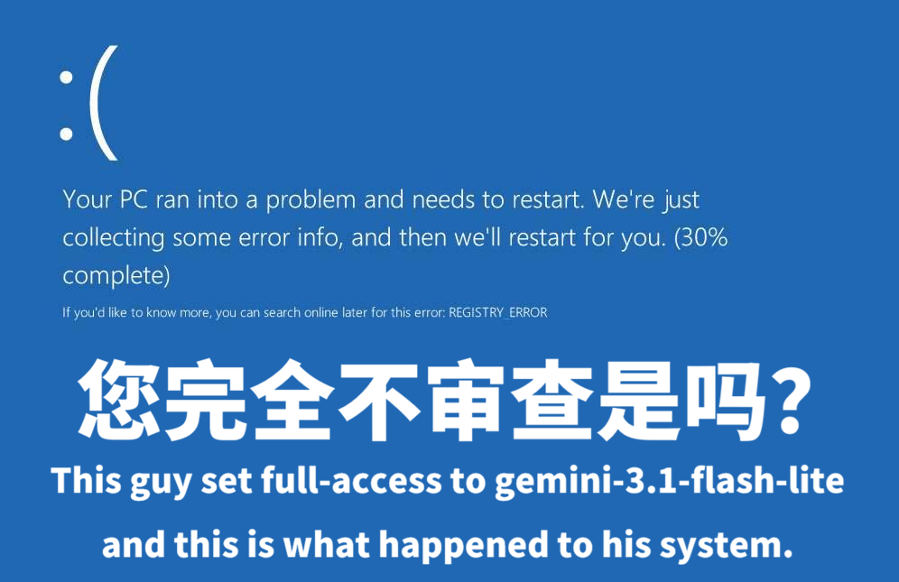
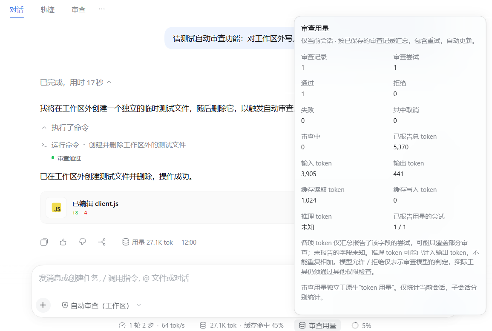

# DSH 审查增强

<a href="imgs/teaser.png"></a>

以 Codex 审查机制为蓝本的可自定义自动审查插件。支持独立审查模型、工作区沙箱、失败回退、删除保护、子代理权限继承，以及审查记录和用量统计。

基于官方实验性插件 `@deepseek-ai/dsh-experimental-auto-review` 二次开发，当前尚未完整实现所有 Codex 审查功能。

npm 安装：`dsh plugin add dsh-auto-review-desktop@0.4.10`  
GitHub 安装：`dsh plugin add github:NekoErwin/dsh-auto-review-desktop#v0.4.10`

[English](README.md) · [下载发布包](https://github.com/NekoErwin/dsh-auto-review-desktop/releases) · [反馈问题](https://github.com/NekoErwin/dsh-auto-review-desktop/issues)

**兼容 dsh 0.2.0+** · 插件版本 **0.4.10** · MIT 许可证

## 能做什么

- **两种权限模式**：日常工作保留工作区沙箱，也可以在完全访问模式中逐次审查每个实际操作。
- **独立选择审查模型**：跟随会话模型，或使用 DSH 中另一个已配置的模型。
- **分别配置审批策略**：工作区外请求可交给人工或模型；模型拒绝、审查故障分别设置处理方式。
- **覆盖子代理**：原生子代理继承增强审查；需要人工批准的请求也会逐项汇总到主会话。
- **审查记录和用量**：在当前会话查看模型判定、完整操作参数、重试及已报告的 token 用量。
- **中英文界面**：菜单、设置和审查展示跟随 DSH 选择的语言。

本插件独立运行，无需启用官方实验性自动审查插件，如果你同时安装了两者，推荐关闭官方插件。

### 比官方插件多了什么

对比基于官方 `@deepseek-ai/dsh-experimental-auto-review` **0.2.2-rc.1** 及同版本宿主行为。

| 功能 | 本插件 | 官方实验性插件 |
| --- | --- | --- |
| 审查模型与推理开销 | 可跟随会话模型，或独立选择已配置模型及受支持的推理档位，并设置审查限额 | 仅跟随主模型 |
| 工作区与只读免审 | 工作区模式可对符合条件的工作区操作、以及设定范围内的原生只读操作跳过模型审查 | Auto 模式逐次审查原生调用和已启动的 PTC 内层调用，没有工作区/只读免审 |
| 子代理继承与人工审批 | 原生子代理继承审查模式和回退策略；需要人工审批时逐条出现在主会话 | 原生子代理可继承官方 Auto，但人工审批固定为 `never` 自动拒绝 |
| 专用审查记录与用量 | 提供持久审查页和会话审查用量汇总 | 只统计会话开销 |

<a href="imgs/image1.png"></a>

## 安装

请先确认使用 **DSH 0.2.0 或更高版本** 的 Web/Desktop 界面。下方 CLI 命令用于安装管理，本版设置和审查展示面向图形界面。

打开 **插件 → 安装**，任选一种来源：

| 来源 | 填写内容 |
| --- | --- |
| npm | `dsh-auto-review-desktop@0.4.10` |
| GitHub | `github:NekoErwin/dsh-auto-review-desktop#v0.4.10` |

使用 DSH CLI 时：

```sh
# npm
dsh plugin add dsh-auto-review-desktop@0.4.10

# GitHub，固定发布标签
dsh plugin add github:NekoErwin/dsh-auto-review-desktop#v0.4.10
```

同一个 profile 选择一种来源即可。离线或本地安装可从 [GitHub Releases](https://github.com/NekoErwin/dsh-auto-review-desktop/releases) 下载 `.tgz`，在插件管理器选择“本地包”。npm 包和 GitHub 发布标签均包含客户端构建，无需用户自行编译或安装 React；包中不声明 install、postinstall、prepare 或 prepack 生命周期脚本。

安装或升级应用后，按 DSH 提示重启，并刷新原有页面。插件变更影响整个 profile。

## 开始使用

1. 打开 **设置 → 增强审查**。保留“跟随会话模型”，或选一个已配置模型作为审查模型；API 凭据仍在 DSH 原生模型设置中管理。
2. 在会话权限菜单选择模式：

| 模式 | 行为 |
| --- | --- |
| **自动审查（工作区）** | 兼容的原生工作区操作在 DSH `workspace-write` 沙箱内运行，免模型审查；其他请求按工作区外策略处理。 |
| **自动审查（完全访问）** | 会话使用完全访问，每个实际操作都送交模型审查。 |

3. 打开会话的 **审查** 页签查看结果；底部原生 token 用量旁的 **审查用量** 展示当前会话审查模型的已报告用量。

也可以用 `/permission auto-review-workspace` 或 `/permission auto-review-desktop` 切换。保存设置不会自动切换会话权限模式。

## 使用前了解这些默认值

| 设置 | 默认值 |
| --- | --- |
| 工作区模式的工作区外请求 | 人工批准 |
| 工作区模式的原生只读范围 | 全部路径，仍受原生工具限制 |
| 模型拒绝 / 审查故障 | 拒绝操作 |
| 子代理人工审批 | 继承父代理策略 |
| 审查模型推理强度 | 支持时使用 low |
| 限额 | 60 秒、2,048 输出 token、120,000 输入字符、每轮 100 次尝试、不重试 |
| 精确删除保护 | 对实际送交模型审查的操作开启 |

模型审查会增加请求和 token 消耗，可能产生额外费用。审查用量独立于原生会话 token 用量；提供方未报告的字段显示为未知。模型允许只对本次动作有效，执行仍须通过其他权限检查。超时或无效响应不会自动放行。

## 平台与保护范围

运行时识别 DSH 原生 **Windows PowerShell** 和 **Linux/macOS Bash**，路径和工作区边界委托 DSH 处理，不转换 shell 语法。未知或被修改的工具按设置走审批。

沙箱沿用 DSH 官方工作区机制，已通过 Windows 回归和 Windows/Linux/macOS 路径及 Bash 路由模拟测试；**真实 Linux/macOS 系统沙箱仍处于验证阶段，欢迎反馈 issue**。各平台的隔离能力取决于宿主实现。**Windows 当前沙箱约束写入和删除，不隔离读取或网络访问**，不能把免审 shell 当作敏感数据读取或外传隔离。

精确删除保护是针对已送审动作的模型策略。工作区内免模型审查的操作也不经过这项删除检查。它不是操作系统级的删除拦截。

## 本地数据、升级与卸载

审查历史保存在 profile 的 `.plugin-data/dsh-auto-review-desktop/history/`。**其中包含完整工具参数和模型拒绝理由，可能含有敏感任务数据；目前没有自动轮转。** 另有独立轮转的统计日志，不记录操作参数、会话正文或拒绝理由。

升级或停用前，请先停止增强会话的工作。停用会取消正在运行的增强任务，并将已加载增强会话降为工作区访问/人工审批。升级后按需重新选择增强模式；正常退出应用会保留已选模式。

如需清除本地审查数据，请先打开 **设置 → 增强审查 → 危险区域 → 清理本地数据**，完成确认后再通过 DSH 插件管理器移除插件。清理会先停止本插件的审查和持久化，再删除**当前 profile 中本插件的审查历史与统计日志**；不删除配置、凭据、会话或其他插件的数据。

**清理不可撤销。** 请先停止使用同一 profile 的其他 DSH 实例。核对页面显示的目录和文件数量，并在一分钟内输入 `DELETE` 确认。清理过程中会使用 profile 下预留的 `.auto-review-desktop-cleanup/` 暂存目录；若操作中断，该目录可能残留，下次预览会一并显示以便重试。若停止审查或删除失败，页面会报告失败，数据可能仍有残留；停止审查超时时，请重启 DSH 后重试。清理后若要继续使用增强审查，需要重新加载插件。直接移除插件不应被视为已经清除了本地数据。

## 更多说明

- [详细行为与边界](docs/technical-reference.zh.md)
- [英文技术说明](docs/technical-reference.md)
- [构建与测试](docs/development.zh.md)
- [发布流程与检查清单](docs/release.zh.md)
- [许可证](LICENSE)与[第三方代码来源](NOTICE.md)

反馈问题时请附插件版本、DSH 版本、操作系统和脱敏后的最小示例。不要上传 API key、完整私有会话或未经脱敏的审查历史。
